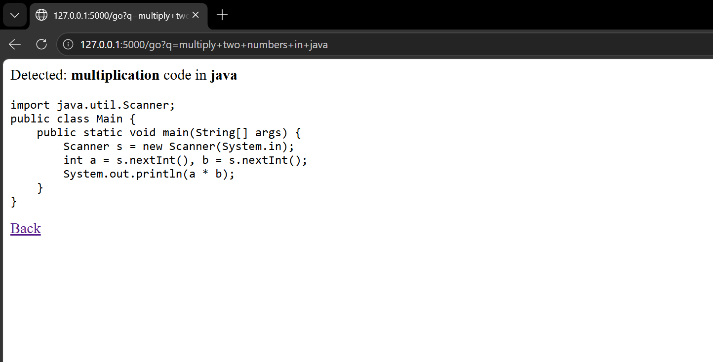

# AI Study Helper

A small AI tool built in Python. In one box, a student can ask for a basic program (C, C++, Java, Python) or a school math problem (class 1 to 8), by typing it or by uploading a photo. Everything runs on a laptop, with no outside AI service and no API key.

Built by Om Sonani, B.Tech 5th semester, YOUR COLLEGE NAME.

## Screenshots

| Home | Code answer | Photo answer |
|---|---|---|
|  |  |  |

## What it can do

- **Code generator:** addition, subtraction, multiplication and division programs in C, C++, Java and Python.
- **Math solver with steps:** BODMAS expressions, word forms like `5 plus 3`, fractions, percentages, simple equations like `3x + 5 = 20`, and area and perimeter of a rectangle, square, circle and triangle.
- **Photo input:** upload a photo of a printed problem and it is read and solved.
- **Hindi and Gujarati sentences:** the classifier understands simple requests such as `બે સંખ્યાનો ભાગાકાર`.

## How it works

1. The user types a question or uploads a photo.
2. A photo is turned into text with Tesseract OCR.
3. A text classifier that I trained myself (scikit-learn, TF-IDF with character n-grams and logistic regression) decides if the request is code or math. Test accuracy was 0.98 on my dataset.
4. For code, a template library returns the program in the chosen language.
5. For math, my own step-by-step solver shows each step. SymPy is used for equations.

What I built and trained: the intent classifier, the training data, the code templates and the step-by-step math solver.
Open-source tools used: Flask, scikit-learn, SymPy, Tesseract OCR.

## Run it

1. Install Python 3.11 and Tesseract OCR (Windows installer from UB Mannheim, into `E:\Tesseract-OCR`).
2. Create an environment and install the libraries:

```
python -m venv .venv
.\.venv\Scripts\Activate.ps1
python -m pip install -r requirements.txt
```

3. If your Tesseract folder is different, change the path in `core/ocr.py`.
4. Train the model (a trained one is included in `models/`):

```
python train/make_data.py
python train/make_math_data.py
python train/train_intent.py
```

5. Start the app and open http://127.0.0.1:5000

```
python app.py
```

## Limits

- Photos work best with clear, printed text. Handwriting is not reliable.
- Word problems such as "Ravi has 5 apples..." are not supported yet.
- The training data is small, so unusual sentences can be classified wrongly.

## Future work

- More programs: factorial, prime, even/odd and star patterns.
- Hindi and Gujarati text in photos.
- Word problems.
- A mobile app (for example in Flutter) that calls this as a backend.