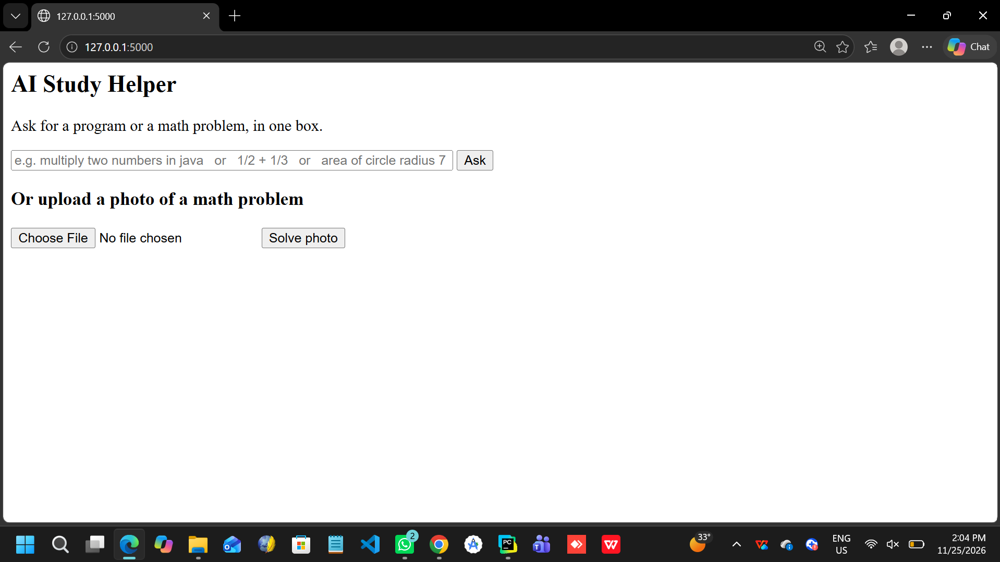
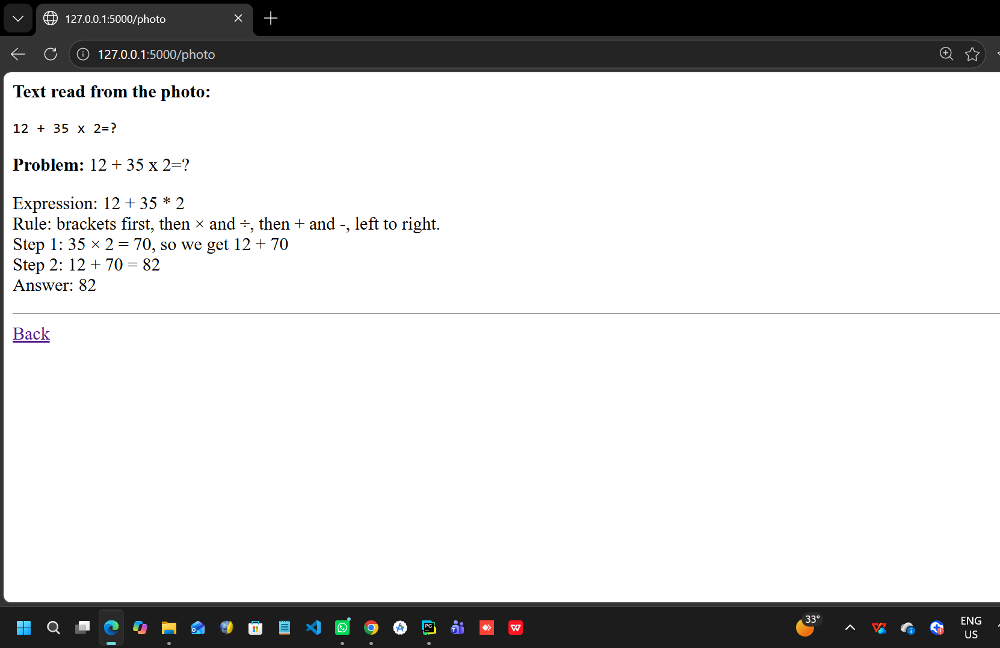

# AI Study Helper

A small AI tool built in Python. In one box, a student can ask for a basic program (C, C++, Java, Python) or a school math problem (class 1 to 8), by typing it or by uploading a photo. Everything runs on its own code, with no outside AI service and no API key.

Built by Om Sonani, B.Tech 5th semester, SSASIT (GTU), Surat.

**Live demo:** https://ai-study-helper-0bnp.onrender.com (the free server sleeps when unused, so the first load can take about a minute)

## Screenshots

| Home | Code answer | Photo answer |
|---|---|---|
|  |  |  |

## What it can do

- **Code generator:** addition, subtraction, multiplication and division programs in C, C++, Java and Python.
- **More programs:** factorial, prime number, even or odd, Fibonacci series and a star pattern, in the same four languages.
- **Math solver with steps:** BODMAS expressions, word forms like `5 plus 3`, fractions, percentages, simple equations like `3x + 5 = 20`, and area and perimeter of a rectangle, square, circle and triangle.
- **Photo input:** upload a photo of a printed problem and it is read and solved. The text that was read is shown, so mistakes are easy to spot.
- **Hindi and Gujarati sentences:** the classifier understands simple requests such as `બે સંખ્યાનો ભાગાકાર`.

## How it works

1. The user types a question or uploads a photo.
2. A photo is turned into text with Tesseract OCR. Several image sizes are tried, and the first clean math line is used.
3. A text classifier that I trained myself (scikit-learn, TF-IDF with character n-grams and logistic regression) decides which arithmetic program is wanted, or whether the request is math. Test accuracy was 0.98 on my dataset.
4. Requests for factorial, prime, even/odd, Fibonacci and patterns are matched by keyword rules (English, Hindi and Gujarati words), not by the trained model.
5. For code, a template library returns the program in the chosen language.
6. For math, my own step-by-step solver shows each step. SymPy is used for equations. The solver refuses a line it cannot fully understand, instead of guessing.

What I built: the intent classifier and its training data, the code templates, the keyword rules and the step-by-step math solver.
Open-source tools used: Flask, scikit-learn, SymPy, Tesseract OCR.

## Run it on your computer

1. Install Python 3.11 and Tesseract OCR (Windows installer from UB Mannheim).
2. Create an environment and install the libraries:

```
python -m venv .venv
.\.venv\Scripts\Activate.ps1
python -m pip install -r requirements.txt
```

3. `core/ocr.py` looks for Tesseract at `E:\Tesseract-OCR\tesseract.exe` first, and then on the system path. If yours is somewhere else, change `_WINDOWS_PATH` in that file.
4. Train the model (a trained one is included in `models/`):

```
python train/make_data.py
python train/make_math_data.py
python train/train_intent.py
```

5. Start the app and open http://127.0.0.1:5000

```
python app.py
```

## Hosting

The project includes a `Dockerfile` that installs Tesseract and trains the model while building. The live demo runs on Render's free plan, built from this repository.

## Limits

- Photos work best with clear, printed text. Handwriting is not reliable, and a small or blurry photo can be misread (the page shows the text that was read).
- Photos are read in English only.
- Word problems such as "Ravi has 5 apples..." are not supported yet.
- The training data is small, so unusual sentences can be classified wrongly.

## Future work

- Word problems.
- Hindi and Gujarati text in photos.
- More programs and more math topics.
- A mobile app (for example in Flutter) that calls this as a backend.